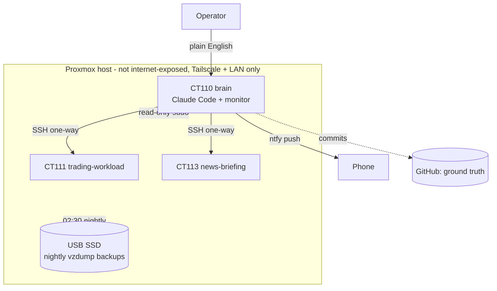

# Citadel

Self-managing Proxmox homelab: a Claude-orchestrated LXC fleet of isolated projects.

Citadel is a clean-slate rebuild of a personal homelab, designed around lightweight, well-isolated containers, security-first defaults, and GitHub as the single source of truth for every configuration change.

---

## Overview

Citadel runs a small fleet of trusted internal workloads as **LXC containers** on a single Proxmox host. A Claude "orchestration brain" container manages the rest via SSH and executes plain-English instructions through Claude Code.

The host is **not internet-exposed**. Access is gated through Tailscale, which serves the perimeter/entry-control role a bastion would otherwise fill.

---

## Architecture



Key decisions are recorded as ADRs in `docs/adr/`; things that broke and what changed are in `docs/incidents.md`.

---

## Operations

- **Monitoring:** `monitoring/citadel-monitor.sh` (hourly systemd timer on the brain) alerts via ntfy if any container's newest backup is older than 26 h or the SSD thin pool passes 70% / 80% on Data% or Meta%.
- **Backups:** nightly, with a restore test of one container passed (2026-10-08); a monthly automated restore drill is written (`ops/host/`) but staged, not installed. See `docs/backup-plan.md`.
- **Infrastructure as code:** `terraform/` defines the brain and news-briefing containers and passes `validate` in CI. It has **not been applied**; the import `plan` is waiting on a scoped Proxmox API token. The provider can't manage raw LXC options, so TUN passthrough stays in `playbooks/`.
- **CI:** shellcheck, yamllint, Terraform fmt/validate, gitleaks.

---

## Design principles

- **Isolate everything.** Each project lives in its own container, independently created, snapshotted, rebuilt, or deleted without affecting the others.
- **Security-first defaults.** No internet exposure, key-only SSH, default-deny firewall, Tailscale-only access, hardening applied uniformly.
- **GitHub as ground truth.** Every configuration change is committed here. Nothing is the "real" state unless it's in the repo.
- **Design before execution.** Architecture and reasoning are worked out first; execution is handed to Claude Code only once the foundation is solid.
- **Human-in-the-loop.** Automated pipelines require explicit approval before any consequential action. Spend caps on metered APIs are built in from day one.
- **Protect the SSD.** Never `dd` directly to the SSD; snapshot sparingly to avoid filling the thin pool; monitor thin-pool usage.

---

## Fleet

| Component | Type | Role |
|---|---|---|
| Claude Orchestration Brain | LXC | Manages other containers via SSH; runs Claude Code; executes plain-English instructions. |
| Trading research workload | LXC | Paper-trading research workload: strategy logic fills simulated orders against live read-only market data into a local SQLite ledger (timestamp, price, size, balance) for P&L and drawdown review. No wallet or keys; spend caps and explicit human approval are required before any real-money step. Isolated, with no SSH path to the brain. |
| Daily News Briefing | LXC | RSS aggregation + Claude Code CLI synthesis (subscription-based, not a metered API key), usage-capped, served privately over LAN/Tailscale only. Own GitHub repo + deploy key; deliberately not part of the fleet SSH mesh. |

Projects do **not** compare data against one another, so each keeps its own local storage — no shared database, no unification layer.

---

## Access model

- No internet exposure; no port forwarding. (Verified: external scan of ports 22/8006/3128 returned closed.)
- Reachable only via **Tailscale** and the **private LAN**.
- Proxmox host firewall: default-deny inbound; allow only management ports from Tailscale + LAN.

---

## Hardening baseline

Applied uniformly across all containers:

- Ubuntu 24.04 LTS, minimal footprint
- Key-only SSH: `PasswordAuthentication no`, `PermitRootLogin no`
- Non-root sudo user for daily use
- `fail2ban` (defense-in-depth; primary control is key-only + Tailscale)
- UFW default deny incoming; allow only what is needed
- Tailscale installed, key expiry disabled (reauth from a local session, not over Tailscale-routed SSH)
- Snapshot before and after significant changes — sparingly, to protect the thin pool
- Nightly `vzdump` backups of every container to a separate physical disk (USB SSD), 02:30 America/New_York, keep 7 daily + 4 weekly, root-only, restore-tested — see `docs/backup-plan.md`

---

## Repository structure

```
citadel/
├── README.md
├── LICENSE
├── .github/workflows/   # CI
├── docs/                # specs, ADRs (adr/), incidents, backup plan, network
├── containers/          # per-container manifest.yaml (fleet/orchestration metadata only)
├── playbooks/           # hardening baseline, TUN passthrough
├── monitoring/          # backup-age + thin-pool monitor and systemd units
├── ops/host/            # host-side monthly restore drill (staged, not installed)
└── terraform/           # definitions for CT110 and CT113 (validated, not applied)
```

*(Structure will evolve as the build progresses.)*

---

## Status

Clean-slate rebuild, started July 2026.

- [x] Host prep: confirmed no internet exposure; firewall cleaned and verified; LVM activation fix in place
- [x] Claude orchestration brain LXC
- [x] prediction-market trader LXC (live, hardened, paper-trading POC phase — docs reconciled 2026-10-07)
- [x] Daily News Briefing LXC (CT113, 192.0.2.33) — live, hardened, pipeline verified end-to-end (RSS → Claude Code CLI synthesis → static HTML → nginx, LAN/Tailscale-only)
- [x] Fleet SSH collapsed to hub-and-spoke (brain → leaves only), stale keys removed (2026-10-08)
- [x] Nightly backups to USB SSD, restore-tested (2026-10-08); SSD thin-pool metadata undersize found and fixed
- [ ] Off-site backup copy
- [x] Monitoring and push alerts for backup age and SSD pool usage (2026-10-09)
- [x] CI, ADRs, incident log (2026-10-09)
- [ ] Terraform: code written and validated; not applied (import `plan` pending a scoped API token)
- [ ] Monthly automated restore drill: written, not yet installed on the host
- [ ] Ansible

---

## Notes

This is a sanitized export of a private working repository: addresses use the RFC 5737 documentation range and workload names are generalized. Secrets, keys, and `.env` files are excluded via `.gitignore` and never committed.
