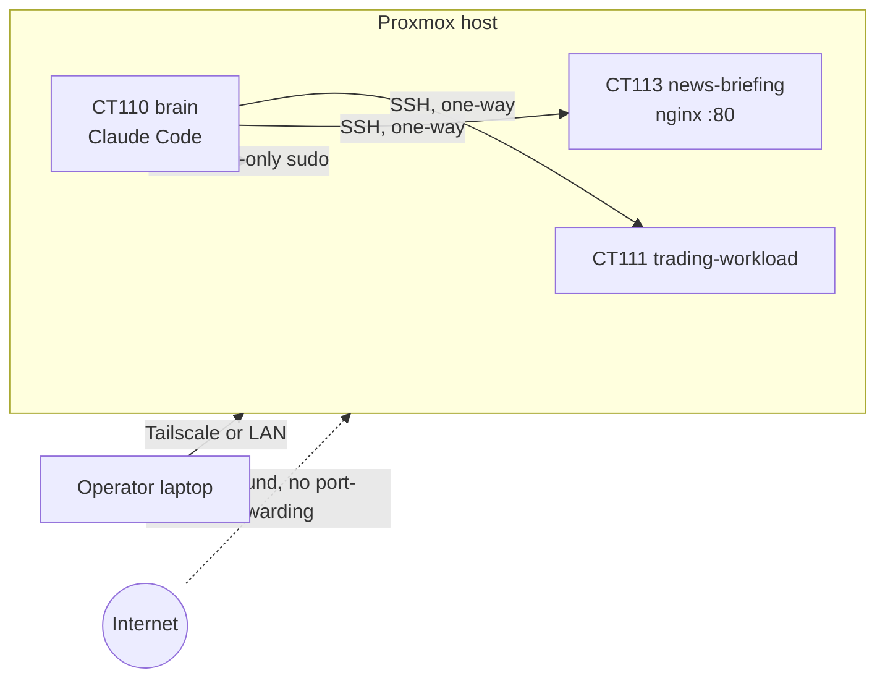

# Network and access model

## Addressing
- LAN `192.0.2.0/24`, gateway `192.0.2.1` (the home router, **not** the Proxmox host). Host `192.0.2.23`; static IPs per container.
- Tailscale (`100.64.0.0/10`) is the remote perimeter; there is no separate bastion. Key expiry is disabled on nodes, and re-auth is done from a LAN session, never over Tailscale-routed SSH.

## Rules
- **Nothing is internet-exposed.** An external scan of 22/8006/3128 returned closed; no router port-forwarding.
- Host firewall: default-deny inbound; 8006/22/5900-5999 allowed from Tailscale and LAN only.
- Every container: key-only SSH, `ufw` default-deny (+22), `fail2ban`, unattended security upgrades.
- SSH is **brain → leaf only**; no leaf can reach the brain or another leaf (ADR 0003).
- The news site is served on 80/tcp, scoped to LAN + Tailscale by `ufw`.
